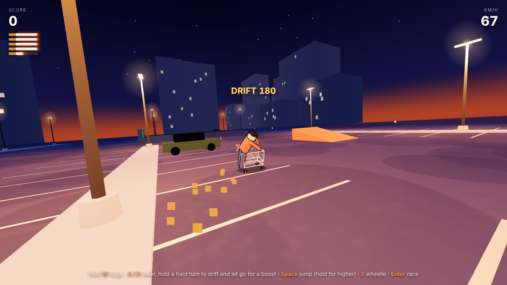

# Shopping Cart Game

A night-time arcade prototype about messing around with supermarket trolleys in an empty car park, under orange street lights.



Browser game built with Vite, TypeScript, Three.js and Rapier physics.

## Play

```bash
npm install
npm run dev
```

Then open the link Vite prints.

| Action | Keyboard | Gamepad | Touch |
| --- | --- | --- | --- |
| Go: run, then ride and kick along | hold `W` / `↑` | `RT` or `X` | PUSH |
| Steer / drift / spin in the air | `A` `D` / `←` `→` | left stick | drag left side |
| Jump | `Space` | `A` | HOP |
| Wheelie (riding) / brake (on foot) | `S` / `↓` | stick back | drag down |
| Passenger throws a can | `F` | `B` or `RB` | THROW |
| Start or abandon a race | `Enter`, or roll into the green ring | Start | RACE |
| Get back up early after a bail | `R` | `Y` | ↺ |

Hold go and the character runs with the cart, jumps on by themselves once it is moving fast enough, and keeps kicking it along. The handling is arcade, not realistic.

- **Cigarettes are stamina.** Going faster than cruising speed burns them. They come back slowly on their own; packs around the lot give three at once.
- **Steering** is kart-style: the cart goes where it points, tighter at low speed. Tap for a nudge, hold for a full turn.
- **Drift:** hold a hard turn at speed and after a moment the back steps out and the cart turns tighter, throwing sparks. Points build while you hold it; let go and you get a speed boost out of the corner, bigger the longer you held.
- **Wheelie:** hold back to lift the nose and let go to bank the points.
- **Jump:** tap for a short hop, hold for a full one. Pressing just before you land still counts, so hops chain.
- **Air:** jump anywhere, or use the kicker ramps, funbox and big launch ramp in the south-west corner. Steer in the air to spin; 180s and 360s score.
- **Kerb hop:** jump onto or off a kerb island for a bonus.
- **Crew:** teens hang around the lot. Roll past one slowly and they hop in the basket, then throw cans at rival riders (slows them down) and traffic cones.
- **Race:** roll into the green RACE ring by the start (or press `Enter`) for two laps against four other kids: up the centre lane, down through the underground level and back. Each kid has their own pace and lane, and the pack stays close. Barge into one to knock them off line, or have your passenger hit them with a can. Best time is saved in the browser.
- **Bails:** tip over or slam into something solid and everyone on the cart ragdolls. You are stood back up after a second.

## Look

Cartoon and stylised: flat toon shading with hard light bands, ink outlines on characters, a dusk sky and a silhouetted skyline. The references are Inside (mood, haze, silhouettes) and OlliOlli World (bold flat colour). It all lives in `src/style.ts`.

## Code

```
src/
  main.ts            renderer, game loop, chase camera
  physics.ts         Rapier world, collision groups, ground raycast
  cart.ts            push, ride, steer, stamina, tricks, bails (tuning constants at the top)
  person.ts          blocky teen: poses and ragdoll (player, passengers, rivals)
  crew.ts            teens who hop in, and can throwing
  race.ts            circuit, rival riders, checkpoints, lap timing
  pickups.ts         cigarette packs
  fx.ts              particles: drift sparks, landing dust, boost bursts
  lights.ts          pool of real lights moved to the lamps nearest the camera
  style.ts           toon materials, outlines, sky and skyline
  input.ts           keyboard, gamepad, touch
  hud.ts             score, speed, cigarettes, race status, popups
  scene/parkingLot.ts  car park, ramps, underground level and colliders
public/assets/       Blender .glb models go here later
```

Everything is primitive shapes for now. The feel of the cart is tuned in the `TUNE` block at the top of `src/cart.ts`.

## Deploy

`.github/workflows/deploy.yml` builds and publishes to GitHub Pages on every push to `main`. One-time setup: in the repo's **Settings → Pages**, set **Source** to **GitHub Actions**.
